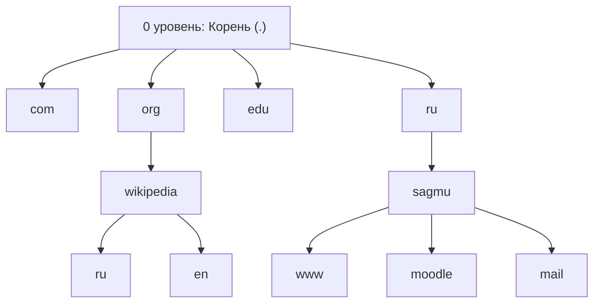
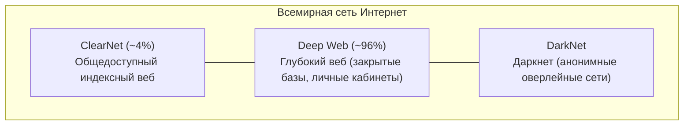

---
{"dg-publish":true,"permalink":"/lekczii/informatika/infa-1109/","dg-note-properties":{}}
---

Дата: 13 ноября 2026 (13.11.2026)
Тема: Поисковые системы в Интернете. Поиск информации с применением векторной модели

[Ссылка на презентацию](https://orioks.miet.ru/storage/d/2167639/cd8a38b46e853d16e53e7c12bfd37beb06cbc2da/%D0%9B%D0%B5%D0%BA%D1%86%D0%B8%D1%8F%209%20%D0%9F%D0%BE%D0%B8%D1%81%D0%BA%D0%BE%D0%B2%D1%8B%D0%B5%20%D1%81%D0%B8%D1%81%D1%82%D0%B5%D0%BC%D1%8B%20%D0%B2%20%D0%98%D0%BD%D1%82%D0%B5%D1%80%D0%BD%D0%B5%D1%82%D0%B5.PPTX)

## Понятие Интернета и статистика

> [!abstract] Определение
> **Интернет** — всемирная система объединенных компьютерных сетей для хранения и передачи информации.

* **Охват аудитории:** по состоянию на октябрь $2026$ года число пользователей интернета в мире превышает $6\text{ млрд}$ человек, что составляет более $75\%$ населения Земли (около $25\%$ населения планеты все еще не имеют доступа к сети либо имеют нестабильное подключение).
* **Масштабы контента:**
  * В мире насчитывается более $1\,100\,000\,000$ ($1.1\text{ млрд}$) сайтов, однако активными из них являются лишь около $15\text{–}18\%$ (остальные — заброшенные страницы и неактуальные ресурсы).
  * Ежедневно создается более $250\,000$ новых сайтов (около $3$ сайтов каждую секунду).
* **Безопасность и трафик:**
  * Основную долю сетевого трафика сегодня генерируют не люди (скачивающие фильмы, игры или общающиеся в мессенджерах), а **боты** (поисковые роботы) и **вирусы**.
  * Ежедневно в мире взламывается более $30\,000$ сайтов.

## Основные этапы истории Интернета

* **$1958\text{ г.}$** — создание Агентства передовых исследовательских проектов США ($\text{ARPA}$), начавшего разработки в области соединения вычислительных машин (параллельно в $1959\text{–}1960\text{ гг.}$ аналогичные закрытые эксперименты проводились в СССР).
* **$1961\text{ г.}$** — разработка концепции **пакетной передачи данных** (передача информации не сплошным потоком, а отдельными фрагментами — пакетами).
* **$1962\text{ г.}$** — первое официально зафиксированное соединение двух удаленных компьютеров.
* **$1969\text{ г.}$** — запуск компьютерной сети **$\text{ARPANET}$**, в которой были реализованы первые алгоритмы маршрутизации и поиска кратчайшего пути между узлами.
* **$1971\text{ г.}$** — изобретение электронной почты ($\text{E-mail}$).
* **$1974\text{ г.}$** — появление термина *Internet*.
* **$1976\text{ г.}$** — создание первой локальной сети по технологии **$\text{Ethernet}$** (проводное соединение узлов, используемое и сегодня).
* **$1982\text{ г.}$** — утверждение стека сетевых протоколов **$\text{TCP/IP}$**, ставшего единым языком общения устройств в сети.
* **$1991\text{ г.}$** — создание технологии гипертекстовых документов **$\text{WWW}$** (World Wide Web — Всемирная паутина) и появление первого в мире веб-сайта.
* **$1993\text{ г.}$** — появление первых графических интернет-браузеров.
* **$1994\text{ г.}$** — появление первых интернет-магазинов и онлайн-банков.
* **$1999\text{ г.}$** — первые случаи государственной цензуры в Интернете в ряде стран.
* **$2005\text{ г.}$** — становление концепции **$\text{Web } 2.0$** (переход от статических страниц, требующих знаний программирования для публикации, к платформам, где контент создают сами пользователи: социальные сети, блоги, форумы).
* **$2009\text{ г.}$** — появление первой криптовалюты.
* **$2011\text{ г.}$** — общее число сайтов в мире превысило $357\text{ млн}$.
* **$2015\text{ г.}$** — массовое внедрение облачных технологий и Интернета вещей ($\text{IoT}$).
* **$2020\text{ г.}$** — повсеместное распространение нейросетевых сервисов и приложений.

## Архитектура, адресация и маршрутизация

Физически Интернет представляет собой объединение локальных сетей через узлы и шлюзы с помощью подземных, подводных (трансокеанских) магистральных кабелей и спутниковых каналов связи.

### Адресация в сетях $\text{TCP/IP}$

> [!abstract] Определение
> **Адресация** — процесс, при котором вычислительное устройство обращается к определенному сегменту памяти или удаленному узлу сети с использованием уникальных идентификаторов. Каждый пакет данных содержит адрес получателя.

Каждый компьютер в сетях $\text{TCP/IP}$ имеет адреса **трех уровней**:

1. **Физический адрес ($\text{MAC}$-адрес):** «паспорт» сетевой карты устройства, прошитый на аппаратном уровне.
2. **Сетевой адрес ($\text{IP}$-адрес):** логический адрес, определяющий местоположение узла в сети.
3. **Символьный адрес ($\text{DNS}$-имя):** понятное человеку текстовое доменное имя сайта или узла.

### Сравнение протоколов $\text{IPv4}$ и $\text{IPv6}$

Логический $\text{IP}$-адрес имеет иерархическую структуру и состоит из двух обязательных частей: **номера сети** и **номера узла** в этой сети (например, в адресе `192.168.18.11` часть `192.168.18` идентифицирует подсеть, а `11` — конкретный компьютер).

| Характеристика | $\text{IPv4}$ | $\text{IPv6}$ |
| :--- | :--- | :--- |
| **Разрядность адреса** | $32\text{ бита}$ (состоит из сетевой и хостовой частей) | $128\text{ бит}$ (префикс глобальной маршрутизации, $\text{ID}$ подсети и $\text{ID}$ интерфейса) |
| **Формат записи** | Десятичная запись через точку (например, `109.26.17.100`) | Шестнадцатеричный формат ($0\text{–}9$, $A\text{–}F$) через двоеточие |
| **Мин. размер макс. пакета** | $576\text{ байт}$ | $1280\text{ байт}$ |
| **Назначение адресов** | Сетевой и широковещательный адреса нельзя назначать конечным устройствам | Сетевой и широковещательный адреса могут назначаться интерфейсам устройств |
| **Шифрование** | Требуется применение внешних технологий ($\text{VPN}$) | Встроенное шифрование на уровне протокола ($\text{IPsec}$) |

### Маршрутизация

> [!abstract] Определение
> **Маршрутизация** — процесс определения и выбора наилучшего пути следования пакета данных по сети от источника к адресату.

* Задачу маршрутизации решают **маршрутизаторы** на основе **таблиц маршрутизации**, содержащих сведения о номерах и масках подсетей назначения, адресах шлюзов, собственных портах и метриках стоимости пути (задача поиска кратчайшего пути на графах).
* Проверить доступность узла и отследить цепочку маршрутизаторов до него в командной строке можно с помощью утилиты трассировки (`tracert` / `traceroute`).

### Система доменных имен ($\text{DNS}$)

> [!abstract] Определение
> **$\text{DNS}$ (Domain Name System)** — распределенная компьютерная система для получения информации о доменах, прежде всего для преобразования символьного доменного имени в числовой $\text{IP}$-адрес.

Иерархия доменных имен читается справа налево:

* **$0$-й уровень:** корень доменного пространства (точка).
* **$1$-й уровень (домены верхнего уровня):** географические (`.ru`, `.uk`) или тематические (`.com` — коммерческие, `.org` — некоммерческие организации, `.edu` — образовательные).
* **$2$-й уровень:** основное имя ресурса или организации (например, `wikipedia.org`, `miet.ru`).
* **$3$-й уровень (поддомены):** конкретные сервисы или языковые версии (например, `ru.wikipedia.org`, `orioks.miet.ru`).
* **$\text{FQDN}$ (Fully Qualified Domain Name):** полностью определенное доменное имя, завершающееся точкой корня (например, `://google.com.`).

## Структура сегментов Интернета (модель айсберга)

1. **$\text{ClearNet}$ (Видимый интернет, $\approx 4\%$):** общедоступные веб-страницы, которые индексируются стандартными поисковыми системами (Яндекс, Google) и открываются без авторизации.
2. **$\text{Deep Web}$ (Глубокий интернет, $\approx 96\%$):** неиндексируемая часть сети, доступ к которой требует авторизации, прав доступа или динамического запроса к базе данных. Примеры: личные кабинеты образовательных порталов (ОРИОКС), электронная почта, закрытые чаты в мессенджерах, банковские кабинеты, научные базы (eLibrary).
3. **$\text{DarkNet}$ (Даркнет):** скрытый сегмент сети со сложной многоуровневой маршрутизацией и шифрованием трафика (например, луковая маршрутизация в сети $\text{Tor}$), доступный только через специальное программное обеспечение.

> [!warning] Замечание
> Если $\text{Deep Web}$ — это абсолютно легальная и необходимая часть повседневной работы в сети (личные аккаунты, корпоративные базы), то $\text{DarkNet}$ часто используется для противоправной деятельности и мошенничества, поэтому посещение его ресурсов сопряжено с высокими рисками безопасности.

## Поисковые системы и этапы информационного поиска

> [!abstract] Определение
> **Поисковая система** — веб-сервис (программно-аппаратный комплекс), предоставляющий пользователю возможность поиска информации в Интернете.

> [!abstract] Определение
> **Информационный поиск** — набор последовательных операций, выполняемых с целью нахождения и выдачи релевантной информации по заданным критериям.

**Основные этапы информационного поиска:**

1. Формирование пользователем информационного запроса.
2. Определение системой всех возможных источников данных по поисковому индексу.
3. Извлечение информации из найденных информационных массивов.
4. Представление результатов пользователю (в современных системах — часто в виде сводного ответа нейросети и списка ссылок на первоисточники).

### Поисковый робот (краулер / «паук»)

> [!abstract] Определение
> **Поисковый робот** — специальная программа поисковой системы, осуществляющая автоматический обход веб-страниц для их анализа и пополнения поисковой базы.

* Попадая на веб-страницу, робот считывает ее содержимое, выделяет ключевые слова, **индексирует** страницу (заносит структурированные сведения о ней в базу данных поисковика) и сохраняет ее копию в архив.
* Найдя на странице гиперссылки на другие документы, робот переходит по ним и повторяет процесс, непрерывно строя карту Интернета.

### Этапы формирования поисковой выдачи

1. **Балансировка нагрузки:** распределение поступившего запроса на наименее загруженный сервер поисковой системы.
2. **Проверка кэша:** поиск готового ответа в оперативной памяти поисковика (если популярный запрос — например, «поздравление с Новым годом» — уже многократно задавался ранее, система мгновенно выдает сохраненный результат без повторного обхода индекса).
3. **Определение типа результата и интента запроса:** классификация, что именно ищет пользователь (текст, картинки, видео, карты), и определение характера запроса — **информационный** (поиск ответа на вопрос) или **коммерческий** (намерение купить товар или заказать услугу).
4. **Применение фильтров:** отсеивание результатов по дате, языку, региону или специальным операторам запроса.
5. **Ранжирование результатов:** сортировка найденных документов по степени их соответствия запросу (**релевантности**).

## Векторная модель информационного поиска ($\text{VSM}$)

> [!abstract] Определение
> **Векторная модель семантики (Vector Space Model, $\text{VSM}$)** — алгебраическая модель представления текстовых документов и поисковых запросов в виде векторов (точек) в едином многомерном пространстве терминов.

### Математическая суть модели

* Пусть словарь коллекции состоит из $D$ уникальных терминов (слов), а сама коллекция включает $N$ документов.
* Каждый $i$-й документ представляется в виде $D$-мерного вектора $\vec{d}_i = (w_{i1}, w_{i2}, \dots, w_{iD})$, где координата $w_{ij}$ обозначает **вес** (значимость) $j$-го термина в $i$-м документе.
* Вся коллекция документов сводится в матрицу «документ — термин» размерности $N \times D$:

$$
W = \begin{pmatrix}
w_{11} & w_{12} & \dots & w_{1j} & \dots & w_{1D} \\
w_{21} & w_{22} & \dots & w_{2j} & \dots & w_{2D} \\
\vdots & \vdots & \ddots & \vdots & \ddots & \vdots \\
w_{i1} & w_{i2} & \dots & w_{ij} & \dots & w_{iD} \\
\vdots & \vdots & \ddots & \vdots & \ddots & \vdots \\
w_{N1} & w_{N2} & \dots & w_{Nj} & \dots & w_{ND}
\end{pmatrix}
$$

* Поисковый запрос пользователя также преобразуется в вектор $\vec{q} = (q_1, q_2, \dots, q_D)$ в том же пространстве.
* **Оценка релевантности:** семантическая близость документа $\vec{d}_i$ и запроса $\vec{q}$ оценивается по геометрической близости их векторов (углу $\theta$ между ними или расстоянию в пространстве). Чем меньше угол $\theta$ между вектором запроса и вектором документа, тем выше **релевантность** документа и тем выше он поднимается в поисковой выдаче.

> [!example] Пример
> При запросе *«Расписание МИЭТ Программная инженерия»*:
> 1. На первом месте окажется страница, содержащая все термины запроса в нужной комбинации (вектор документа максимально близок к вектору запроса).
> 2. Ниже расположится общая страница *«Расписание МИЭТ»* (частичное совпадение координат вектора).
> 3. Еще ниже — просто главная страница сайта МИЭТ или расписание другого вуза (большое угловое расстояние между векторами).

## Поисковая оптимизация ($\text{SEO}$)

> [!abstract] Определение
> **$\text{SEO}$ (Search Engine Optimization — поисковая оптимизация)** — комплекс мер по внутренней и внешней оптимизации веб-сайта с целью повышения его позиций в результатах выдачи поисковых систем по целевым запросам (попадание в $\text{ТОП-}10$ или $\text{ТОП-}3$).

**Основные направления $\text{SEO}$:**

* **Внутренняя оптимизация:**
  * Обеспечение высокой релевантности, уникальности и полноты контента под целевые запросы пользователей.
  * Удобная навигация, корректная структура ссылок и поведенческие факторы (анализ зон внимания и кликов пользователей на странице).
* **Внешняя оптимизация:**
  * Наращивание ссылочной массы — размещение ссылок на сайт в авторитетных каталогах и на сторонних ресурсах, чтобы поисковые роботы чаще переходили на сайт и повышали его индекс доверия.
* **Интеграция с социальными сетями:**
  * Связывание сайта с официальными сообществами в соцсетях для генерации дополнительного трафика и индексации.

## Специальные возможности и язык поисковых запросов

Помимо стандартного текстового поиска, современные поисковые системы поддерживают **визуальный поиск** (поиск по изображению: поиск похожих картинок, определение объекта на фото), интерактивные виджеты (например, палитра кодов цветов при запросе цвета) и «пасхальные яйца» (например, запрос `do a barrel roll` в Google, заставляющий страницу сделать оборот на $360^\circ$, или интерактивные лапки при поиске «кошка»/«собака»).

Для точной фильтрации выдачи применяется **язык поисковых операторов**:

| Оператор | Назначение и принцип работы | Пример использования |
| :--- | :--- | :--- |
| `+` | Обязательное присутствие слова в найденном документе | `информатика +векторная модель` |
| `-` | Исключение документов, содержащих указанное слово | `купить телефон -бу` |
| `!` | Поиск слова строго в заданной словоформе (падеже, числе) | `!москва` |
| `" "` | Поиск точной фразы или цитаты с сохранением порядка слов | `"векторная модель информационного поиска"` |
| `*` | Подстановка любого пропущенного слова внутри точной фразы | `"плохие программисты думают о *"` |
| `\|` | Логическое «ИЛИ» — поиск страниц, содержащих хотя бы одно из слов | `расписание (лекций \| семинаров)` |
| `site:` / `url:` / `host:` | Ограничение поиска конкретным сайтом, доменом или страницей | `site:miet.ru расписание` |
| `mime:` | Поиск файлов строго определенного формата ($\text{PDF}$, $\text{DOCX}$ и др.) | `рабочая программа mime:pdf` |
| `lang:` | Поиск документов на конкретном языке | `vector space model lang:en` |
| `date:` | Фильтрация документов по дате публикации (формат `ГГГГММДД`) | `новости ИИ date:>=20260101` |
