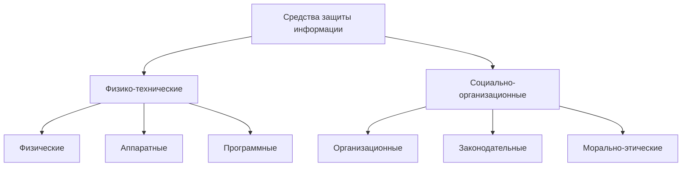
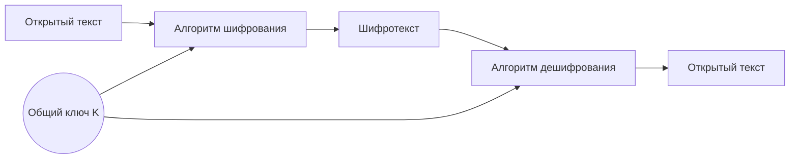
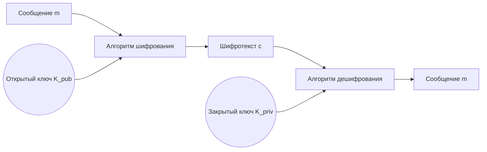

---
{"dg-publish":true,"permalink":"/lekczii/informatika/infa-1110/","dg-note-properties":{}}
---

Дата: 20 ноября 2026 (20.11.2026)
Тема: Информационная безопасность. Программно-технические методы и средства защиты информации

[Ссылка на презентацию](https://orioks.miet.ru/storage/d/2167640/760998c132fb394b8017adfed1746a00003bcbdb/%D0%9B%D0%B5%D0%BA%D1%86%D0%B8%D1%8F%2010.%D0%98%D0%BD%D1%84%D0%BE%D1%80%D0%BC%D0%B0%D1%86%D0%B8%D0%BE%D0%BD%D0%BD%D0%B0%D1%8F%20%D0%B1%D0%B5%D0%B7%D0%BE%D0%BF%D0%B0%D1%81%D0%BD%D0%BE%D1%81%D1%82%D1%8C.%20%D0%9F%D1%80%D0%BE%D0%B3%D1%80%D0%B0%D0%BC%D0%BC%D0%BD%D0%BE-%D1%82%D0%B5%D1%85%D0%BD%D0%B8%D1%87%D0%B5%D1%81%D0%BA%D0%B8%D0%B5%20%D0%BC%D0%B5%D1%82%D0%BE%D0%B4%D1%8B%20%D0%B8%20%D1%81%D1%80%D0%B5%D0%B4%D1%81%D1%82%D0%B2%D0%B0%20%D0%B7%D0%B0%D1%89%D0%B8%D1%82%D1%8B%20%D0%B8%D0%BD%D1%84%D0%BE%D1%80%D0%BC%D0%B0%D1%86%D0%B8%D0%B8.PPTX)

## Понятие информационной безопасности и классификация угроз

> [!abstract] Определение
> **Информационная безопасность (ИБ)** — это защищенность информации и поддерживающей инфраструктуры от случайных или преднамеренных воздействий естественного или искусственного характера, чреватых нанесением ущерба владельцам или пользователям информации и поддерживающей инфраструктуры.

Под **поддерживающей инфраструктурой** понимаются технические и программные средства, каналы связи и помещения, с помощью которых информация хранится, передается, обрабатывается и предоставляется пользователям.

### Базовая классификация угроз ИБ

В зависимости от того, какое базовое свойство информации нарушается, выделяют четыре основных класса угроз:

1. **Нарушения конфиденциальности** — несанкционированное получение закрытых сведений посторонними лицами.
2. **Нарушения достоверности** — отклонение информации от соответствия истине, доказанному научному знанию и объективной действительности.
3. **Нарушения целостности** — искажение, внесение ошибок или потеря части информации при хранении или передаче.
4. **Нарушения доступности** — ограничение или полная невозможность получения информации легитимным пользователем.

### Подробный разбор классов угроз

#### 1. Нарушения конфиденциальности

Данный тип угроз связан с попаданием личных, коммерческих или государственных данных в чужие руки. Выделяют три механизма реализации этой угрозы:

* **Несанкционированный доступ (НСД)** — умышленное проникновение злоумышленника в систему в обход правил разграничения доступа (использование уязвимостей ПО, хакерских утилит, подбор паролей или методов социальной инженерии).
* **Разглашение** — умышленная или неосторожная передача конфиденциальных сведений третьим лицам сотрудником или пользователем, который имел легальный доступ к этим данным, но не имел права их распространять (например, передача государственной или коммерческой тайны).
* **Утечка** — неконтролируемый выход информации за пределы защищаемого периметра без злого умысла, вызванный техническими сбоями или халатностью персонала.

> [!example] Пример
> Сотрудники организации или банка выбрасывают старые бумажные документы с клиентскими базами, номерами счетов и контактами в открытый мусорный контейнер без предварительного уничтожения (шредирования). Посторонние лица получают прямой доступ к конфиденциальным данным без взлома информационных систем.

#### 2. Нарушения достоверности

Информации можно доверять только тогда, когда она является истинной, точной и своевременной. Причины искажения истинности делятся на три группы:

* **Фальсификация** — преднамеренное искажение сведений с целью получения выгоды (финансовой, политической, репутационной) или введения пользователей в заблуждение.
* **Ошибка** — непреднамеренное искажение данных при вводе, опечатках или неточной передаче сведений. Ошибки в открытых источниках (например, в статьях энциклопедий) опасны тем, что на их основе могут обучаться нейросети и строиться дальнейшие исследования.
* **Недостаточная осведомленность автора о теме или объекте** — ситуация, при которой автор публикации добросовестно заблуждается или не обладает достаточной квалификацией, но публикует материал для привлечения трафика.

#### 3. Нарушения целостности

В отличие от нарушения достоверности, здесь информация изначально была корректной, но повредилась в процессе обработки, хранения или передачи:

* **Технические проблемы** — сбои в каналах связи, потеря пакетов при передаче по сети, физический износ носителей информации (например, повреждение флеш-накопителя или жесткого диска).
* **Злой умысел** — целенаправленная порча файлов вредоносным ПО (вирусами, изменяющими байты в файлах) или подавление сигналов с помощью генераторов помех.

#### 4. Нарушения доступности

Пользователь не может вовремя получить нужную ему информацию из-за следующих факторов:

* **Блокирование информации** — временное или постоянное закрытие доступа к ресурсу. Может быть вызвано техническими авариями (обрыв кабеля, отключение интернета), изменением прав доступа (например, увольнением сотрудника или переводом преподавателя) либо действиями вирусов-вымогателей, блокирующих экран или систему до выплаты выкупа.
* **Невосстановимое искажение** — шифрование или модификация данных вредоносным ПО (например, программами-шифровальщиками) с использованием односторонних алгоритмов, при которых ключ дешифрования отсутствует и восстановить исходный файл практически невозможно.
* **Уничтожение информации** — полное физическое или логическое стирание данных (случайное удаление файла пользователем, целенаправленная атака злоумышленника или физическое повреждение сервера, например, при попадании влаги).

### Дополнительные критерии классификации угроз

В более широких моделях угрозы также классифицируют по следующим признакам:

* **По вероятности возникновения:** маловероятные и высоковороятные.
* **По виду и размеру ущерба:** экономический, моральный, политический, репутационный вред.
* **По расположению источника угрозы относительно объекта:** внешние (снаружи организации) и внутренние (сотрудники, внутренние сбои).

## Методы защиты информации

Для противодействия угрозам применяется совокупность базовых методов:

1. **Создание препятствий (барьеров)** — установка паролей, разграничение прав доступа, физическая охрана периметра.
2. **Маскировка (криптография)** — преобразование данных (шифрование) при хранении и передаче так, чтобы их нельзя было прочитать без ключа.
3. **Регламентация** — установление строгих правил работы с информацией, инструкций и распределение полномочий.
4. **Принуждение и побуждение** — создание системы юридической ответственности (законы, штрафы, уголовное преследование) и морально-этических норм, стимулирующих соблюдать правила безопасности.
5. **Активное воздействие (нападение на источник угрозы)** — выявление источника атаки (например, определение $IP$-адреса злоумышленника) и передача данных правоохранительным органам для пресечения атаки.

## 3. Средства защиты информации: физико-технические

Средства защиты делятся на два крупных направления: **физико-технические** (относящиеся к оборудованию и ПО) и **социально-организационные** (относящиеся к человеческому фактору).

### 1. Физические средства защиты

> [!abstract] Определение
> **Физические средства защиты** — это различные типы механических и электронно-механических устройств, создающих физические препятствия при попытках нарушителей воздействовать на компоненты автоматизированной системы, а также технические устройства охранной сигнализации, связи и внешнего наблюдения.

К физическим средствам относятся:
* заборы (в том числе с колючей проволокой), турникеты и пропускные пункты;
* замки на дверях серверных помещений, сейфы для хранения бумажных носителей и резервных копий;
* системы видеонаблюдения, охранная сигнализация и физическая охрана объектов.

### 2. Аппаратные (технические) средства защиты

> [!abstract] Определение
> **Аппаратные средства защиты информации (АСЗИ)** — это специализированные технические устройства, встроенные в архитектуру вычислительной системы или подключаемые к ней, главное назначение которых состоит в обеспечении целостности и сохранности данных путем создания аппаратных препятствий для несанкционированного доступа (в том числе с помощью маскировки).

Примеры аппаратных средств:
* аппаратные межсетевые экраны ($Firewall$) и маршрутизаторы с повышенной защитой;
* экранированные и защищенные кабели связи, фиксирующие попытки физического подключения (врезки) и передающие сигнал тревоги с точностью до метра повреждения;
* генераторы электромагнитных и акустических помех, блокирующие утечку данных по техническим каналам.

### 3. Программные средства защиты

> [!abstract] Определение
> **Программные средства защиты** — это специализированные программы, предназначенные для идентификации и аутентификации пользователей, контроля доступа, шифрования информации, удаления остаточных данных (временных файлов) и тестового контроля системы защиты.

**Преимущества программных средств:**
* универсальность и гибкость настройки;
* простота установки и тиражирования;
* способность к быстрой модификации и регулярному обновлению.

**Недостатки программных средств:**
* расходование вычислительных ресурсов рабочих станций и серверов (снижение производительности);
* высокая чувствительность к случайным сбоям или преднамеренным изменениям кода;
* возможная зависимость от конкретной аппаратной платформы или операционной системы.

#### Архитектура и принципы работы антивирусного ПО

Типовой антивирус состоит из нескольких взаимосвязанных модулей:

* **Модуль обновления** — загружает свежие базы угроз и обновления программных компонентов.
* **Коннектор к антивирусу-серверу** — обеспечивает защищенный канал связи с сервером разработчика (защита от подмены обновлений злоумышленником).
* **Модуль сканера** — проверяет файлы, диски и оперативную память по запросу пользователя или по расписанию.
* **Модуль резидентной защиты (монитор)** — постоянно работает в фоновом режиме и проверяет все открываемые, скачиваемые и запускаемые файлы в реальном времени.
* **Модуль карантина** — изолирует подозрительные файлы в отдельной защищенной области памяти/диска, лишая их возможности взаимодействовать с операционной системой.
* **Модуль «протектора» (самозащиты)** — защищает файлы и процессы самого антивируса и блокирует загрузку вредоносных объектов из сети.

#### Основные методы обнаружения угроз

1. **Сигнатурный анализ** — поиск в файлах уникальных последовательностей байтов (сигнатур), характерных для уже известных вредоносных программ.
2. **Эвристический анализ** — оценка структуры кода и выявление косвенных признаков опасности (нестандартная упаковка файла, подозрительные инструкции, попытки доступа приложения к несвойственным ему данным, например, попытка фоторедактора получить доступ к телефонной книге) без точного совпадения с базой сигнатур.
3. **Поведенческий анализ и песочницы ($Sandbox$)** — запуск подозрительной программы в изолированной виртуальной среде (песочнице) и наблюдение за ее действиями в реальном времени (попытки скрытно изменить системные файлы, прописаться в автозагрузку или массово зашифровать документы).
4. **Машинное обучение и облачные технологии** — применение нейросетевых моделей для выявления аномалий в коде и поведении программ, а также мгновенная сверка хешей подозрительных объектов с облачными базами угроз (что снижает нагрузку на локальный ПК и защищает саму базу сигнатур от повреждения).
5. **Контроль целостности** — сохранение эталонных контрольных сумм (характеристик) системных файлов, загрузочных секторов и модулей самого антивируса с последующей регулярной проверкой на предмет несанкционированных изменений.

## Средства защиты информации: социально-организационные

### 1. Организационные средства защиты

> [!abstract] Определение
> **Организационные средства защиты** — это нетехнические методы и мероприятия, внедряемые и применяемые на постоянной основе на предприятиях (не связанные напрямую с государственным законодательством), направленные на минимизацию рисков человеческого фактора.

Ключевые организационные меры:
* тщательный подбор и проверка надежности кандидатов при приеме на работу;
* составление и подписание соглашений о неразглашении конфиденциальной информации ($NDA$);
* строгое разграничение уровней и прав доступа сотрудников (например, администратор видит всю базу данных, а рядовой пользователь или инспектор — только строго определенную ее часть, необходимую для работы).

### 2. Законодательные (правовые) средства защиты

> [!abstract] Определение
> **Законодательные средства защиты** — это система нормативно-правовых актов, законов и государственных стандартов, устанавливающих правила обращения с информацией и меры юридической ответственности (административной и уголовной) за их нарушение.

> [!warning] Важно
> Правовые методы не способны физически или технически остановить взлом сервера в режиме реального времени — они работают **постфактум**. Их главная функция заключается в сдерживании потенциальных нарушителей за счет неотвратимости наказания (штрафов, лишения свободы) и возмещения ущерба.

#### Основные нормативно-правовые акты РФ в области ИБ

* Федеральный закон от $27.07.2006$ № $149$-ФЗ «Об информации, информационных технологиях и о защите информации».
* Федеральный закон от $07.07.2003$ № $126$-ФЗ «О связи».
* Федеральный закон от $28.12.2010$ № $390$-ФЗ «О безопасности».
* Федеральный закон от $06.04.2011$ № $63$-ФЗ «Об электронной подписи».
* Федеральный закон от $27.07.2006$ № $152$-ФЗ «О персональных данных».

#### Государственные стандарты РФ в области ИБ

* ГОСТ Р $50922$-$2006$ «Защита информации. Основные термины и определения».
* ГОСТ Р $51275$-$2006$ «Защита информации. Объект информатизации. Факторы, воздействующие на информацию. Общие положения».
* Р $50.1.056$-$2005$ «Техническая защита информации. Основные термины и определения».
* ГОСТ Р ИСО/МЭК $15408$-$1$-$2008$ «Информационная технология. Методы и средства обеспечения безопасности. Критерии оценки безопасности информационных технологий» ($3$ части).
* ГОСТ Р ИСО/МЭК $13335$-$1$-$2006$ «Информационная технология. Методы и средства обеспечения безопасности» ($5$ частей).

### 3. Морально-этические средства защиты

> [!abstract] Определение
> **Морально-этические средства защиты** — это сложившиеся в обществе или конкретном коллективе неписаные моральные нормы и этические правила поведения в информационной среде, нарушение которых не влечет юридического наказания, но ведет к потере репутации, авторитета и доверия к человеку или организации.

Примеры соблюдения морально-этических норм: отказ от публикации личных данных друзей и коллег (адресов, телефонов, фотографий) в открытых чатах и социальных сетях без их согласия.

## Комплексная система защиты информации (КСЗИ)

> [!abstract] Определение
> **Комплексная система защиты информации (КСЗИ)** — это единая совокупность организационно-правовых и инженерно-технических мероприятий, направленных на обеспечение защиты информации от разглашения, утечки и несанкционированного доступа на всех этапах ее жизненного цикла.

### Структура КСЗИ

В состав комплексной системы защиты входят следующие взаимосвязанные элементы:
1. **Служба защиты информации** (профильные специалисты, отвечающие за администрирование безопасности).
2. **Комплекс средств защиты от НСД** (программные и аппаратные средства аутентификации и разграничения прав).
3. **Комплекс средств криптографической защиты** (шифрование данных и электронная подпись).
4. **Комплекс средств блокирования технических каналов утечки** (экранирование, генераторы шума).
5. **Физическая охрана объектов** (КПП, видеонаблюдение, сейфы).
6. **Инженерно-технические мероприятия** (проектирование защищенных сетей и помещений).
7. **Регламентация действий пользователей** (должностные инструкции, политика паролей).

### Основные требования к системам защиты информации

Для эффективной работы система защиты информации должна удовлетворять ряду системных требований:

* **Разграничение прав доступа** — каждый пользователь должен иметь доступ только к тем данным, которые необходимы ему для выполнения рабочих задач.
* **Регистрация событий (аудит) и контроль утечек** — система должна фиксировать в защищенных журналах (логах) все входы, выходы, скачивания, просмотры и изменения файлов, чтобы при инциденте можно было установить виновного.
* **Создание доверенной среды** — обеспечение защиты серверов как на программном уровне, так и на физическом (исключение возможности прямого извлечения жесткого диска посторонним лицом).
* **Централизованное управление** — возможность контролировать события безопасности из единого центра управления.

> [!warning] Замечание
> Единый узел управления создает **единую точку отказа (уязвимости)**. Если злоумышленник получит права администратора центрального узла (путем взлома или социальной инженерии), скомпрометированной окажется вся информационная система. В качестве альтернативы в современных системах применяются децентрализованные архитектуры (например, распределенные реестры).

* **Удобство использования ($Usability$)** — механизмы защиты не должны чрезмерно усложнять работу пользователя. Если система требует вводить по $5$ сложных паролей подряд или менять их каждый день, пользователи начнут записывать пароли на стикерах, использовать одинаковые комбинации или сохранять их в незащищенных браузерах, что резко снизит реальный уровень безопасности.

## Криптография: задачи и классические шифры

> [!abstract] Определение
> **Криптография** — это наука о методах обеспечения конфиденциальности (невозможности прочтения информации посторонним), целостности данных (невозможности незаметного изменения информации), аутентификации (проверки подлинности авторства или иных свойств объекта) и шифрования (кодирования данных).

### Основные задачи криптографии

1. **Обеспечение конфиденциальности** — преобразование открытого текста в шифротекст, недоступный для понимания без секретного ключа.
2. **Обеспечение аутентификации** — подтверждение того, что сообщение отправлено именно тем пользователем, который указан в качестве отправителя (передача логинов и паролей в виде криптографических хешей, исключающих восстановление исходного пароля при перехвате).
3. **Проверка целостности данных** — использование криптографических хеш-функций для гарантии того, что документ не был изменен при передаче.
4. **Предотвращение отказа от авторства (неотрекаемость)** — использование электронной подписи, доказывающей, что конкретный автор действительно создал и отправил документ.

### Классические шифры подстановки

#### 1. Шифр Цезаря

**Принцип работы:** каждый символ открытого текста заменяется символом, находящимся на некотором постоянном числе позиций $k$ (ключ сдвига) левее или правее него в алфавите (циклически).

Если пронумеровать буквы алфавита мощности $m$ числами от $0$ до $m - 1$, то математически шифрование символа с номером $x$ и дешифрование символа с номером $y$ записываются следующим образом:

$$y = (x + k) \bmod m$$

$$x = (y - k + m) \bmod m$$

где:
* $x$ — порядковый номер буквы исходного текста;
* $y$ — порядковый номер буквы шифротекста;
* $k$ — величина сдвига (ключ);
* $m$ — количество букв в алфавите (для русского алфавита $m = 33$, для английского $m = 26$).

> [!example] Пример
> Пусть используется русский алфавит ($m = 33$) и сдвиг вправо на $k = 3$ позиции. Тогда:
> * буква «А» (позиция $0$) переходит в букву «Г» (позиция $3$);
> * буква «Б» (позиция $1$) переходит в букву «Д» (позиция $4$);
> * буква «Я» (позиция $32$) циклически переходит в букву «В» (позиция $(32 + 3) \bmod 33 = 2$).

> [!warning] Замечание
> Шифр Цезаря обладает крайне низкой стойкостью. Во-первых, число возможных ключей ограничено длиной алфавита ($m - 1$ вариантов), что легко перебирается. Во-вторых, шифр легко взламывается методом **частотного анализа**: злоумышленник подсчитывает частоту появления символов в шифротексте и сопоставляет самые частые символы с наиболее употребительными буквами языка (в русском языке это гласные «О», «Е», «А» и согласные «Н», «Т», «С»).

#### 2. Шифр Атбаш

**Принцип работы:** зеркальное отражение алфавита, при котором первая буква заменяется на последнюю, вторая — на предпоследнюю и так далее.

Правило замены $n$-й буквы алфавита (при нумерации от $1$ до $m$) задается формулой:

$$n' = m - n + 1$$

где:
* $n$ — порядковый номер исходной буквы ($1 \le n \le m$);
* $n'$ — порядковый номер зашифрованной буквы;
* $m$ — число букв в алфавите.

> [!example] Пример
> * Буква «А» ($n = 1$) заменяется на «Я» ($n' = 33 - 1 + 1 = 33$).
> * Буква «Б» ($n = 2$) заменяется на «Ю» ($n' = 33 - 2 + 1 = 32$).
> * Буква «В» ($n = 3$) заменяется на «Э» ($n' = 33 - 3 + 1 = 31$).
>
> Для повышения стойкости шифр Атбаш иногда комбинируют со сдвигом (как в шифре Цезаря), однако он также уязвим к частотному анализу и полному перебору на современных ЭВМ.

#### 3. Квадрат Полибия

**Принцип работы:** шифр простой замены, в котором алфавит и цифры записываются в двумерную матрицу (таблицу). Каждому символу ставится в соответствие пара координат: номер строки $i$ и номер столбца $j$.

Пример матрицы размера $6 \times 6$ для латинского алфавита ($26$ букв) и цифр от $0$ до $9$ ($10$ символов):

| | $1$ | $2$ | $3$ | $4$ | $5$ | $6$ |
| :---: | :---: | :---: | :---: | :---: | :---: | :---: |
| **$1$** | A | B | C | D | E | F |
| **$2$** | G | H | I | J | K | L |
| **$3$** | M | N | O | P | Q | R |
| **$4$** | S | T | U | V | W | X |
| **$5$** | Y | Z | $0$ | $1$ | $2$ | $3$ |
| **$6$** | $4$ | $5$ | $6$ | $7$ | $8$ | $9$ |

> [!example] Пример
> Используя приведенную выше таблицу:
> * символ «A» находится на пересечении $1$-й строки и $1$-го столбца $\rightarrow$ код $11$;
> * символ «O» находится на пересечении $3$-й строки и $3$-го столбца $\rightarrow$ код $33$;
> * слово «CAT» зашифруется как последовательность двузначных чисел: $13\; 11\; 42$.

## Современные виды шифрования и абсолютная стойкость

### Симметричное шифрование

> [!abstract] Определение
> **Симметричное шифрование** (шифрование с закрытым ключом) — это способ шифрования, в котором для зашифровывания и расшифровывания данных используется один и тот же секретный ключ $K$, известный обеим взаимодействующим сторонам.

**Особенность и уязвимость:** необходимость безопасной передачи общего ключа $K$ по защищенному каналу связи. Если злоумышленник перехватит ключ $K$, он сможет расшифровать всю переписку.

### Асимметричное шифрование

> [!abstract] Определение
> **Асимметричное шифрование** (шифрование с открытым ключом) — это криптографическая система, использующая пару математически связанных ключей: **открытый ключ** $K_{pub}$ (передается по открытым каналам и используется для шифрования) и **закрытый ключ** $K_{priv}$ (хранится в строгом секрете у получателя и используется для расшифрования).

Асимметричное шифрование основано на сложных математических задачах (односторонних функциях с лазейкой) и применяется повсеместно в мессенджерах, социальных сетях и протоколах защищенного соединения ($HTTPS$).

### Теория абсолютно стойкого шифра (Клод Шеннон)

В $1945$ году американский математик и криптограф Клод Шеннон в работе «Математическая теория криптографии» сформулировал математическое понятие **абсолютно стойкого шифра** (шифра, который невозможно взломать даже при наличии неограниченных вычислительных мощностей, так как перехваченный шифротекст не содержит никакой статистической информации о ключе и исходном тексте).

> [!note] Теорема (Условия абсолютной стойкости шифра по К. Шеннону)
> Шифр является теоретически абсолютно стойким (невскрываемым), если выполняются следующие четыре условия:
> 1. **Одноразовость ключа:** ключ генерируется заново для каждого отдельного сообщения и используется строго один раз (метод одноразового блокнота).
> 2. **Статистическая надежность ключа:** вероятности появления каждого из возможных символов в ключе равны, а сами символы в ключевой последовательности статистически независимы и истинно случайны.
> 3. **Длина ключа:** длина ключа $L_{key}$ должна быть больше или равна длине передаваемого сообщения $L_{msg}$:
>    $$L_{key} \ge L_{msg}$$
> 4. **Избыточность исходного текста:** открытый текст должен обладать некоторой естественной избыточностью (смысловой структурой языка), которая служит критерием оценки правильности расшифровки на стороне получателя (короткие односложные сообщения без контекста могут при переборе ключей дать несколько осмысленных, но ложных вариантов расшифровки).

## Практические рекомендации по защите от угроз ИБ

Для минимизации рисков утечки данных и противодействия современным атакам (включая социальную инженерию и фишинг) необходимо соблюдать базовые правила цифровой гигиены:

1. **Бдительность и защита от социальной инженерии:**
   * не вводить личные и платежные данные на сомнительных сайтах и при подключении к открытым публичным сетям $Wi$-$Fi$;
   * критически относиться к неожиданным сообщениям от имени руководства, банков или знакомых (особенно в мессенджерах и домовых чатах), так как аккаунты могут быть взломаны или сфальсифицированы;
   * не переходить по подозрительным ссылкам и не открывать вложения от неизвестных отправителей.
2. **Парольная политика:**
   * использовать длинные, сложные и уникальные пароли для каждого сервиса;
   * не сохранять критически важные пароли в открытом виде и не использовать один пароль для разных учетных записей (чтобы компрометация одного сайта не привела к взлому всех остальных);
   * периодически обновлять пароли.
3. **Актуальность ПО и антивирусная защита:**
   * использовать лицензионное антивирусное ПО с включенной резидентной защитой и регулярно обновлять его базы;
   * своевременно устанавливать обновления операционной системы и прикладных программ для закрытия обнаруженных уязвимостей.
4. **Резервное копирование:**
   * регулярно создавать резервные копии важных файлов на независимых физических носителях (флеш-накопителях, внешних дисках) и в надежных облачных хранилищах для защиты от программ-шифровальщиков и аппаратных сбоев.